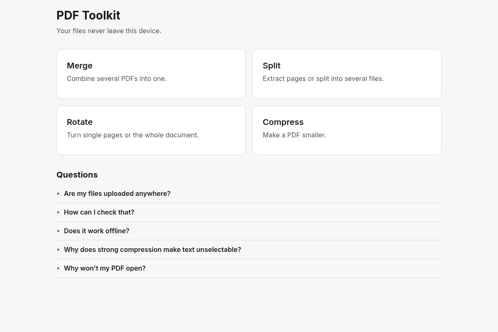
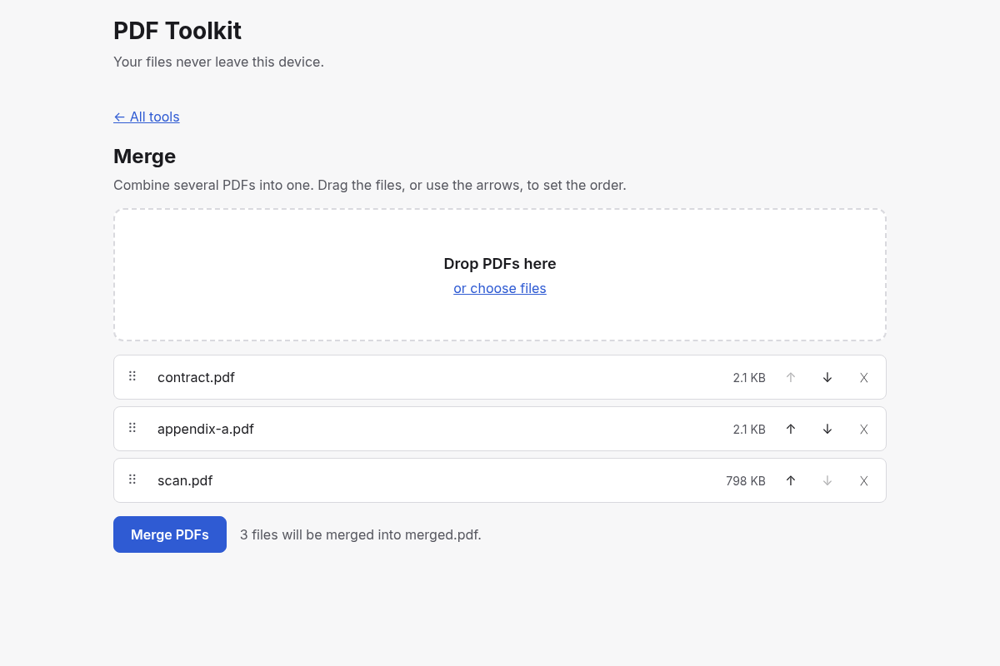
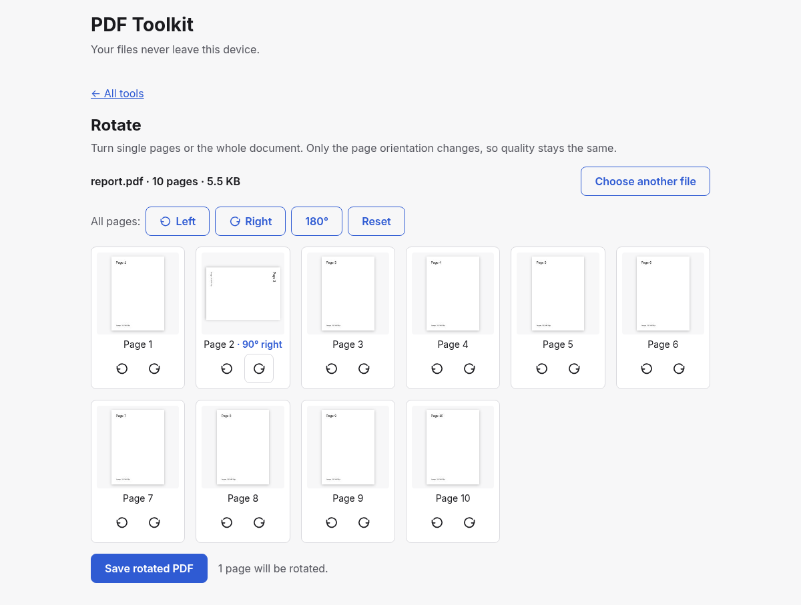
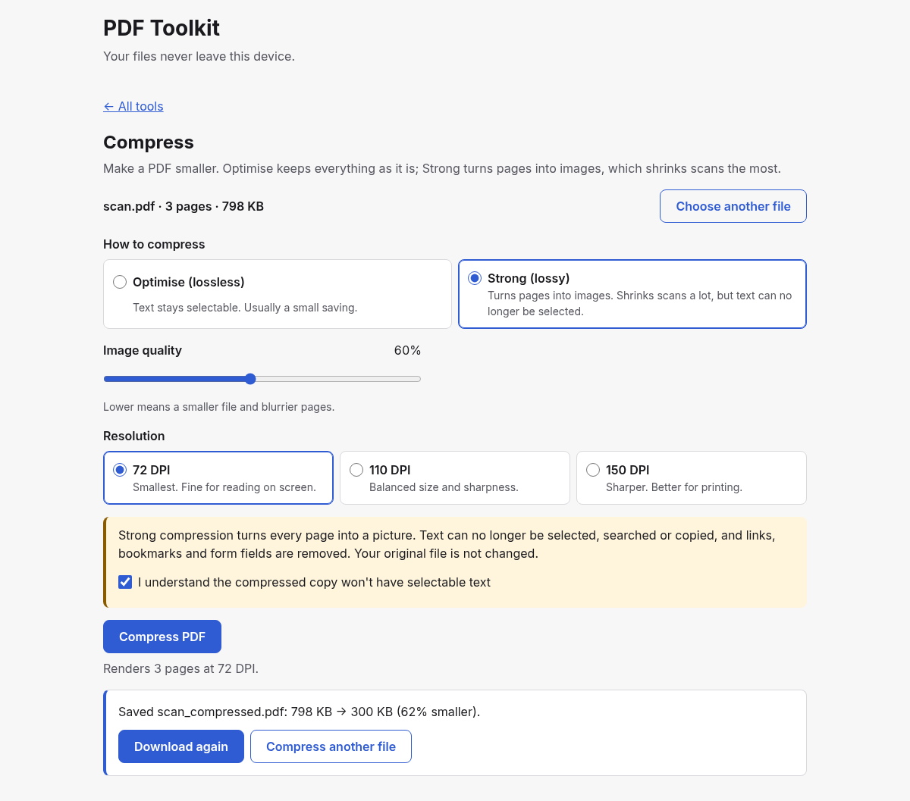
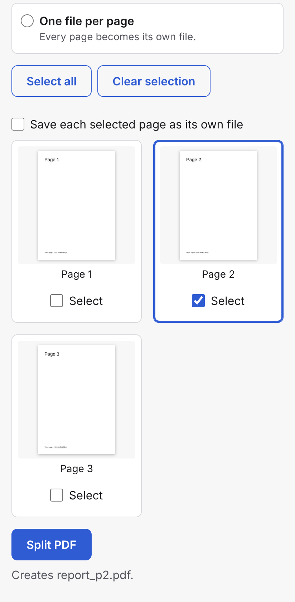
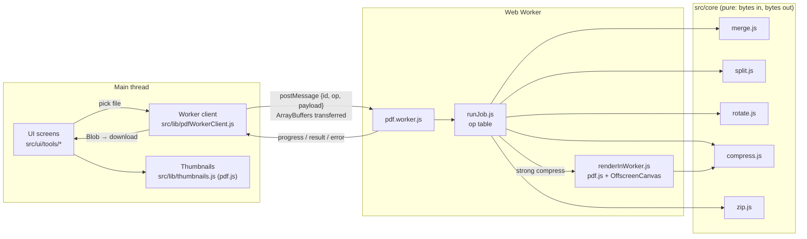

# PDF Toolkit

[](https://github.com/Alexman39/PDF-Toolkit/actions/workflows/ci.yml)
[](LICENSE)

**Merge, split, rotate and compress PDFs in your browser. Your files never leave your device.**

👉 **Live app: <https://alexman39.github.io/PDF-Toolkit/>**

Most free PDF websites upload your documents to a server. This one doesn't have a server: every
operation runs in JavaScript on your own device. After the first visit it works offline too.



## Features

| Tool         | What it does                                                                                                                                                                                                   |
| ------------ | -------------------------------------------------------------------------------------------------------------------------------------------------------------------------------------------------------------- |
| **Merge**    | Combine several PDFs into one. Reorder them by dragging (mouse or touch) or with arrow buttons.                                                                                                                |
| **Split**    | Four modes: page ranges (`1-3, 5, 8-`), every N pages, pick pages from thumbnails, or one file per page. Several outputs download as one `.zip`.                                                                |
| **Rotate**   | Turn single pages or all of them by ±90° or 180°. Lossless: only the page orientation changes.                                                                                                                  |
| **Compress** | **Optimise (lossless)** re-saves the file more compactly and keeps the text selectable. **Strong (lossy)** turns each page into a JPEG, which shrinks scans a lot, and warns you first that text won't be selectable. |

Also:

- Shows the size before and after compressing. If the result isn't smaller, it says so and offers the original back.
- Checks the `%PDF-` header instead of trusting the file extension. Password-protected and damaged files get a clear message, not broken output.
- Heavy work runs in a Web Worker, with a progress bar and Cancel, so the page never freezes.
- Works with keyboard only, screen readers (ARIA labels, live status messages) and touch. Light and dark themes follow your system.
- Installs nothing and has no accounts, ads or analytics.

|                Merge                 |                 Rotate                 |                   Compress                   |                  Split on a phone                   |
| :----------------------------------: | :------------------------------------: | :------------------------------------------: | :-------------------------------------------------: |
|  |  |  |  |

## Privacy: how it works, and how to check it yourself

"We don't upload your files" is easy to claim. The app is built so that you don't have to take
that on trust:

1. **There is no backend.** The site is a set of static files on GitHub Pages. There is nothing
   that could receive a file.
2. **The browser is told to block all connections.** The page has a
   [Content Security Policy](https://developer.mozilla.org/en-US/docs/Web/HTTP/CSP) with
   `connect-src 'none'`, so `fetch`, XHR, WebSockets and beacons are refused even if some code
   tried them. `default-src 'self'` means scripts, styles and fonts can only come from the site
   itself, with no CDNs and no third parties.
3. **Every library is bundled.** `pdf-lib`, `pdf.js` and `fflate` ship inside the app's own files.
4. **A test enforces it.** [`tests/e2e/privacy.spec.js`](tests/e2e/privacy.spec.js) runs every
   tool in a real browser and fails if the page makes any network request after loading, or
   breaks the CSP. It runs on every push.

### Verify it in your browser

1. Open the [live app](https://alexman39.github.io/PDF-Toolkit/) and open DevTools
   (<kbd>F12</kbd>, or right-click → **Inspect**).
2. Go to the **Network** tab and click 🚫 (**Clear**).
3. Use any tool on a PDF. The list stays empty, or shows only `blob:` entries, which are your
   result being handed to the browser's download manager on your own machine.
4. For a stronger test, set the throttling menu to **Offline** (or turn off Wi-Fi) and reload.
   Everything still works, because a service worker cached the app on your first visit.
5. In the **Elements** tab, look in `<head>` for
   `<meta http-equiv="Content-Security-Policy" …>` to see the policy described above.

## How it's built

Plain JavaScript (ES modules) and CSS, built with [Vite](https://vite.dev/). No framework.



- **`src/core/`** holds the PDF operations as pure functions: `Uint8Array` in, `Uint8Array` out,
  no DOM. The same code runs in the worker and in the Node unit tests, and ESLint rejects
  browser globals there.
- **The worker** keeps the page responsive while large files are processed. Cancel stops the
  worker immediately with `terminate()`, which frees its memory at once.
- **Two PDF libraries**, because each covers what the other can't: `pdf-lib` writes PDFs (merge,
  split, rotate, optimise), and `pdf.js` renders pages (thumbnails, and the images for strong
  compression).
- **The service worker** (`src/sw.js`) caches the built files so the app works offline.

## Run it locally

You need Node.js 20.19 or newer (CI uses Node 24).

```sh
git clone https://github.com/Alexman39/PDF-Toolkit.git
cd PDF-Toolkit
npm install
npm run dev            # http://localhost:5173/PDF-Toolkit/
```

| Command                | What it does                                               |
| ---------------------- | ---------------------------------------------------------- |
| `npm run dev`          | Dev server with hot reload (the CSP is only added to builds) |
| `npm run build`        | Production build to `dist/`                                |
| `npm run preview`      | Serve the production build locally                         |
| `npm run lint`         | ESLint and Prettier check                                  |
| `npm test`             | Unit tests (Vitest)                                        |
| `npm run test:e2e`     | End-to-end tests in Chromium (Playwright)                  |
| `npm run screenshots`  | Regenerate the images in `docs/screenshots/`               |
| `npm run fixtures`     | Regenerate the generated test PDFs in `tests/fixtures/`    |

The first time you run the end-to-end tests, install the browser with
`npx playwright install chromium`.

### Tests

- **Unit** (`tests/unit/`): every core operation, checked against small fixture PDFs (normal,
  scanned, encrypted, corrupt, 150 pages and more), plus the worker protocol and helpers.
- **End-to-end** (`tests/e2e/`): every tool in a real browser against the production build,
  including the privacy test, offline use, a phone with touch only, and keeping the UI
  responsive on large files.

### Continuous integration and deployment

[`.github/workflows/ci.yml`](.github/workflows/ci.yml) runs lint, unit and end-to-end tests on
every push and pull request. On `main`, the build those tests just passed is deployed to GitHub
Pages.

## Known limitations

- Strong compression makes text unselectable. That is the cost of the large size savings, and
  the app says so before running.
- Strong compression is disabled for PDFs that contain JPEG 2000 or JBIG2 images. pdf.js would
  need to download extra decoders for them, which the privacy policy forbids.
- Browsers limit how much memory a page can use, so the app warns when files total more than
  about 200 MB.

## License

[MIT](LICENSE) © 2026 Alexander Maniateas
